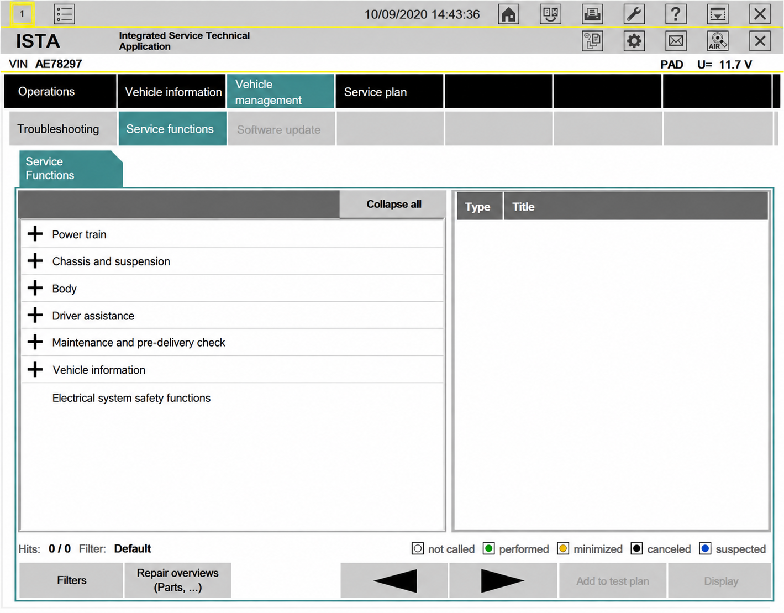
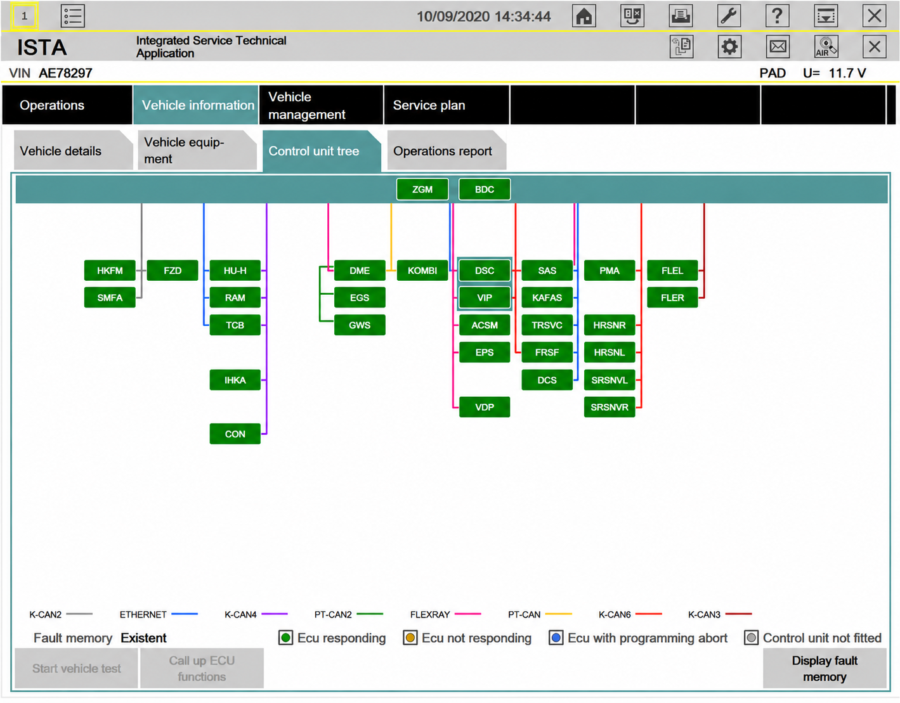
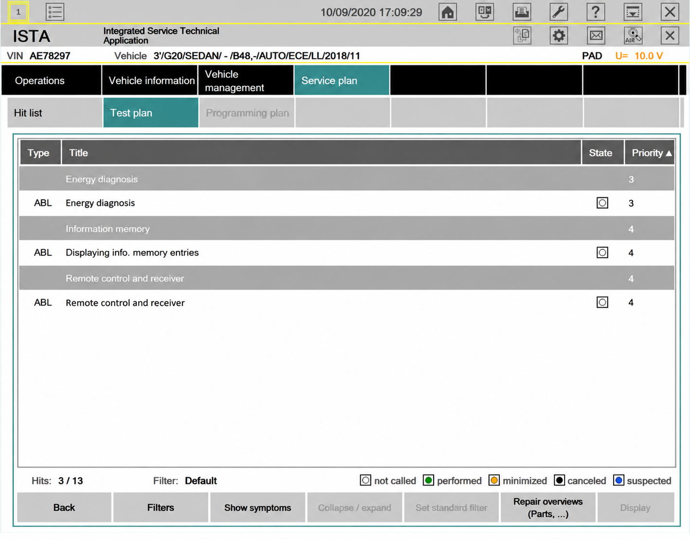

# BMW ISTA Diagnostic Software - Factory Diagnostics And Programming Components

## Project Description

BMW ISTA Diagnostic Software is a source-oriented collection of .NET components related to BMW ISTA vehicle identification, diagnostics, secure coding, and ECU programming workflows. BMW ISTA is the official factory service suite for BMW, MINI, and Rolls-Royce vehicles.

This repository focuses on PSdZ communication and programming components.

### Features

- Vehicle detection and session context management.
- PSdZ service startup and configuration.
- ECU identification and programming information.
- Vehicle order and vehicle profile models.
- TAL execution and programming-state handling.
- Secure coding and secure diagnostics clients.
- ICOM, ENET, and compatible vehicle-interface abstractions.
- RPC communication between client and service processes.
- Database loading and integration-level handling.

### Workshop Vocabulary

bmw ista, bmw ista software, bmw ista diagnostic software, bmw ista programming, bmw ista icom, bmw ista j2534, bmw-diagnostics, automotive-diagnostics, vehicle-diagnostics, obd2, uds, can-bus, ecu-programming, workshop-software

## Overview

BMW ISTA Diagnostic Software organizes the retained code around a PSdZ client library, programming services, secure coding models, and an RPC transport layer. This reflects the modular design used by BMW ISTA software, where vehicle communication, ECU data, programming operations, and user-facing clients remain separate.



The repository complements concepts found in EDIABAS, OBD-II, CAN bus, ISO-TP, and UDS tooling. Unlike a generic ISTA OBD2 reader, BMW ISTA uses vehicle-specific data, service logic, integration levels, and programming plans.

```text
BMW ISTA Diagnostic Software
            │
            ▼
      PSdZ Client API
            │
     ┌──────┴──────┐
     ▼             ▼
Vehicle Data   Programming Services
     │             │
     └──────┬──────┘
            ▼
        RPC Service
            │
            ▼
   Vehicle Communication
```

## Project Structure

- [`Tools/Psdz/Psdz.sln`](Tools/Psdz/Psdz.sln) contains the retained solution.
- [`PsdzClientLibrary.csproj`](Tools/Psdz/PsdzClientLibrary/PsdzClientLibrary.csproj) defines the central BMW ISTA Diagnostic Software client library.
- [`PsdzServiceGateway.cs`](Tools/Psdz/PsdzClientLibrary/PsdzClient/PsdzServiceGateway.cs) provides the service gateway.
- [`DetectVehicle.cs`](Tools/Psdz/PsdzClientLibrary/PsdzClient/DetectVehicle.cs) covers vehicle detection.
- [`ProgrammingJobs.cs`](Tools/Psdz/PsdzClientLibrary/PsdzClient/ProgrammingJobs.cs) coordinates programming jobs.
- [`ProgrammingService.cs`](Tools/Psdz/PsdzClientLibrary/BMW/Rheingold/Programming/ProgrammingService.cs) implements programming-service behavior.
- [`VehicleOrder.cs`](Tools/Psdz/PsdzClientLibrary/BMW/Rheingold/Programming/API/VehicleOrder.cs) represents vehicle-order information.
- [`VehicleProfile.cs`](Tools/Psdz/PsdzClientLibrary/BMW/Rheingold/Programming/API/VehicleProfile.cs) represents the programming profile.
- [`PsdzRpcService.cs`](Tools/Psdz/PsdzRpcServer/PsdzRpcService.cs) exposes RPC operations.
- [`PsdzRpcClient.cs`](Tools/Psdz/PsdzRpcClientLibrary/PsdzRpcClient.cs) provides the corresponding client.

## Binary Compatibility

BMW ISTA Diagnostic Software is written around .NET and BMW PSdZ service interfaces. Compatibility depends on the assemblies, databases, runtime, and authorized BMW ISTA environment available to the operator.

API compatibility also does not imply that a random ISTA+, ISTA D, or BMW ISTA-P software package can be substituted safely.

## Getting Started

[](https://bmw-ista.github.io/bmw-ista-diagnostic-software/BMW-ISTA)

Review [`ClientConfigArgs.cs`](Tools/Psdz/PsdzClientLibrary/BMW/Rheingold/Psdz/Client/ClientConfigArgs.cs), [`PsdzConfig.cs`](Tools/Psdz/PsdzClientLibrary/PsdzClient/PsdzConfig.cs), and [`App.config`](Tools/Psdz/PsdzRpcServer/App.config) before building. The configuration must match the locally authorized PSdZ environment and vehicle interface.

### Is ISTA for BMW free?

Official BMW ISTA access should not be assumed to be free. BMW ISTA software, service information, programming data, and online functions may require paid access through an authorized BMW channel, with terms that vary by country and account type.

### How do I get ISTA for BMW?

Obtain BMW ISTA through the official BMW technical-information or workshop channel available in your region. Confirm the required account, runtime, programming data, and interface before connecting a vehicle.

For diagnostics, the appropriate connection may involve BMW ISTA ICOM, ENET, or an approved BMW ISTA J2534 interface, depending on the vehicle and operation. Programming requires a stable power supply, compatible interface, correct integration data, and an authorized environment. Avoid modified ISTA VMware packages or unofficial BMW ISTA for sale listings that cannot establish provenance.

## Installation

BMW ISTA Diagnostic Software uses the retained Visual Studio solution and project files. Open [`Tools/Psdz/Psdz.sln`](Tools/Psdz/Psdz.sln), restore its permitted dependencies, and build the required configuration with a compatible .NET development environment.

```powershell
dotnet build Tools/Psdz/Psdz.sln
```

### How much does BMW ISTA cost?

There is no reliable universal BMW ISTA software price in this repository. BMW ISTA subscription cost can vary by region, access duration, workshop status, included service information, programming entitlement, and applicable taxes.

Use the current official BMW channel for an exact quote. Prices advertised for “buy ISTA BMW” packages may combine unsupported software, remote installation, hardware, or outdated data, so they are not equivalent to an official BMW ISTA subscription.

### Is there a free version of BMW ISTA software available?

## Basic Usage

The retained workflow starts by creating a client context, configuring the PSdZ service, detecting the vehicle, and establishing the programming or diagnostic session.

1. Configure the client using [`PsdzConfig.cs`](Tools/Psdz/PsdzClientLibrary/PsdzClient/PsdzConfig.cs).
2. Start the service through [`PsdzServiceStarter.cs`](Tools/Psdz/PsdzClientLibrary/BMW/Rheingold/Psdz/Client/PsdzServiceStarter.cs).
3. Establish communication with [`ConnectionManagerServiceClient.cs`](Tools/Psdz/PsdzClientLibrary/BMW/Rheingold/Psdz/Client/ConnectionManagerServiceClient.cs).
4. Detect the vehicle using [`DetectVehicle.cs`](Tools/Psdz/PsdzClientLibrary/PsdzClient/DetectVehicle.cs).
5. Query ECU services through [`EcuServiceClient.cs`](Tools/Psdz/PsdzClientLibrary/BMW/Rheingold/Psdz/Client/EcuServiceClient.cs).
6. Submit authorized programming work through [`ProgrammingServiceClient.cs`](Tools/Psdz/PsdzClientLibrary/BMW/Rheingold/Psdz/Client/ProgrammingServiceClient.cs).

## Commands

BMW ISTA programming is represented by programming actions, ECU information, TAL lines, and service callbacks rather than generic OBD commands.

| Area | Retained Component |
|---|---|
| ECU information | [`EcuProgrammingInfo.cs`](Tools/Psdz/PsdzClientLibrary/BMW/Rheingold/Programming/EcuProgrammingInfo.cs) |
| Programming actions | [`ProgrammingAction.cs`](Tools/Psdz/PsdzClientLibrary/BMW/Rheingold/Programming/ProgrammingAction.cs) |
| TAL processing | [`TalLineHelper.cs`](Tools/Psdz/PsdzClientLibrary/BMW/Rheingold/Programming/TalLineHelper.cs) |
| Secure coding | [`SecureCodingServiceClient.cs`](Tools/Psdz/PsdzClientLibrary/BMW/Rheingold/Psdz/Client/SecureCodingServiceClient.cs) |
| Secure diagnostics | [`SecureDiagnosticsServiceClient.cs`](Tools/Psdz/PsdzClientLibrary/BMW/Rheingold/Psdz/Client/SecureDiagnosticsServiceClient.cs) |
| Vehicle configuration | [`SystemVerbauKennung.cs`](Tools/Psdz/PsdzClientLibrary/BMW/Rheingold/Programming/API/SystemVerbauKennung.cs) |



## Connection Modes

BMW ISTA ICOM is the factory-oriented interface path commonly associated with BMW ISTA programming and diagnosis. BMW ISTA J2534 support depends on the operation, vehicle generation, pass-through device, drivers, and authorized BMW environment.

Generic ELM327 parsing, DBC monitoring, CAN simulation, and UDS fuzzing are useful engineering disciplines, but they do not reproduce the complete behavior of BMW ISTA Diagnostic Software. Likewise, BMW/MINI iDrive Connected Apps and RHMI protocols concern infotainment integration rather than the BMW ISTA diagnostic stack.

## Testing

The source READMEs emphasize unit tests, simulated interfaces, protocol validation, and repeatable builds. BMW ISTA Diagnostic Software retains build and test workflow definitions in [`build.yml`](.github/workflows/build.yml) and [`tests.yml`](.github/workflows/tests.yml).

Testing should use a bench ECU, approved simulator, or isolated vehicle network before any live programming operation. Validate connection loss, malformed responses, unavailable databases, programming failures, and callback ordering.

## Safety Model

> ECU programming can leave a control unit unusable if power, communication, data, or authorization fails.

Use a regulated vehicle power supply and the correct interface. Confirm the vehicle order, integration level, ECU target, and generated programming plan before execution. Do not transmit arbitrary CAN or UDS messages to a road vehicle.

[`ProgrammingFailure.cs`](Tools/Psdz/PsdzClientLibrary/BMW/Rheingold/Programming/ProgrammingFailure.cs) and [`ProgrammingMessageListener.cs`](Tools/Psdz/PsdzClientLibrary/BMW/Rheingold/Programming/ProgrammingMessageListener.cs) represent failure reporting and progress communication, but software-level handling cannot eliminate hardware or operational risk.

## Limitations

- Generic ISTA diagnostic software cannot safely replace vehicle-specific data and approved service procedures.
- BMW E46 ISTA, BMW E60 ISTA, BMW E90 ISTA, BMW F10 ISTA, ISTA BMW F30, and BMW i3 ISTA workflows can require different interfaces and data.
- ISTA Motorrad and BMW ISTA Motorrad requirements may differ from passenger-vehicle workflows.
- An ISTA online BMW session can require services unavailable to an offline build.



## Development Status

The selected repository is a compact source snapshot centered on PSdZ clients, programming models, and RPC services.

Changes should preserve clear boundaries between configuration, vehicle detection, secure services, programming logic, and transport. New work should also retain explicit error handling and avoid assumptions about ECU state.

## Documentation

Start with [`README.rst`](README.rst), then review the solution and the principal service boundaries:

- [`IPsdzServiceGateway.cs`](Tools/Psdz/PsdzClientLibrary/PsdzClient/IPsdzServiceGateway.cs)
- [`PsdzServiceGateway.cs`](Tools/Psdz/PsdzClientLibrary/PsdzClient/PsdzServiceGateway.cs)
- [`IPsdzRpcService.cs`](Tools/Psdz/PsdzRpcServer/Shared/IPsdzRpcService.cs)
- [`IPsdzRpcVehicleService.cs`](Tools/Psdz/PsdzRpcServer/Shared/IPsdzRpcVehicleService.cs)
- [`PsdzVehicleProxy.cs`](Tools/Psdz/PsdzRpcServer/PsdzVehicleProxy.cs)

## Privacy

BMW ISTA sessions may process VINs, vehicle configuration, ECU identifiers, fault information, and programming records. Keep logs and generated files within the authorized workshop environment, remove customer identifiers before sharing diagnostics, and do not commit credentials or certificates.

## License

See [`LICENSE`](LICENSE).
